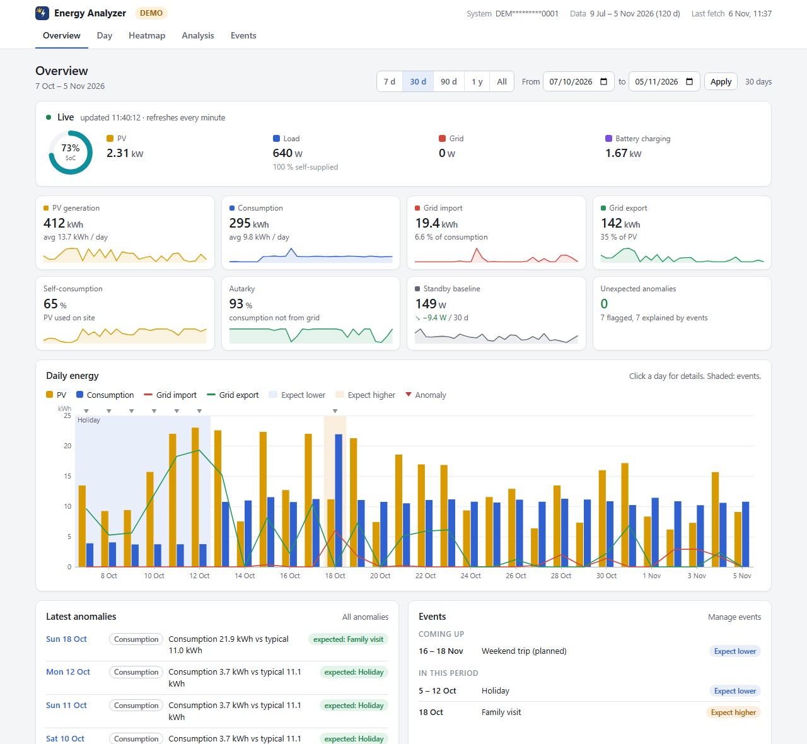

# AlphaESS Energy Analyzer – Kurzanleitung (Deutsch)

Holt die Daten deiner AlphaESS-Anlage (PV, Batterie, Netz) über die AlphaESS Open API in eine
lokale SQLite-Datei und zeigt sie in einem Web-Dashboard und einem Offline-HTML-Bericht. Die
ausführliche Dokumentation steht im englischen [README](README.md).



> **Inoffizielles Community-Projekt.** Nicht mit Alpha ESS verbunden und nicht von Alpha ESS
> unterstützt. Nutzung auf eigene Gefahr; bitte API-Limits und Nutzungsbedingungen beachten.

## Was es kann

- **Dashboard** mit Live-Werten, Tagesenergie, 5-Minuten-Tagesansicht, Last-Heatmap,
  Analyse und Ereignissen. Es funktioniert auf PC und Handy und hat einen Login, sobald es im
  Netzwerk erreichbar ist.
- **Grundlast (Standby)** in der Nacht, mit Trend.
- **Eigenverbrauch und Autarkie** pro Tag, Monat oder Zeitraum.
- **Auffälligkeiten**: ungewöhnliche Grundlast, ungewöhnlicher Verbrauch, seltene nächtliche
  Lastspitzen. Eine Wärmepumpe, die in vielen Nächten anspringt, gilt nach einer Woche als
  normal.
- **Ereignisse**: Urlaub, Gäste, Homeoffice, Heizsaison an/aus, neues Gerät oder Ausfall
  eintragen, auch im Voraus. Die Analyse berücksichtigt sie.
- Alle Daten bleiben lokal; die einzige Verbindung geht zur AlphaESS-API.

## Ausprobieren ohne Konto (Demodaten)

```bash
git clone https://github.com/wintermute422/alphaess-energy-analyzer.git
cd alphaess-energy-analyzer
python3 -m venv .venv && . .venv/bin/activate
pip install .
energy-analyzer serve --demo
```

Dann <http://localhost:8088/> öffnen. Unter Windows statt der dritten Zeile:
`py -m venv .venv` und `.venv\Scripts\activate`.

## Mit den eigenen Daten

1. Auf [open.alphaess.com](https://open.alphaess.com) ein Entwicklerkonto anlegen und die
   Anlage (Seriennummer) hinzufügen. **Developer ID** und **Developer Key** notieren.
2. Einrichten und Zugangsdaten prüfen:
   ```bash
   energy-analyzer init
   cp .env.example .env && chmod 600 .env   # Developer ID und Key in .env eintragen
   energy-analyzer init                     # prüft die Zugangsdaten
   ```
3. Historie laden (ein Monat dauert etwa 10 Minuten wegen des API-Limits) und das Dashboard
   starten:
   ```bash
   energy-analyzer backfill --from 2025-10-01 --to 2025-10-31
   energy-analyzer serve                    # http://localhost:8088/
   ```

## Dauerbetrieb auf einem Linux-Server

Von deinem PC aus, ohne root auf dem Server:

```bash
cp deploy.env.example deploy.env   # Host, Benutzer, Pfad, Web-Port eintragen
bash deploy.sh
```

Das Skript installiert Folgendes als systemd-Benutzerdienste:
- den nächtlichen Abruf
- die Aktualisierung alle 15 Minuten
- das Dashboard

Das Dashboard-Passwort wird auf dem Server erzeugt und nie angezeigt. Lesen kannst du es dort
mit `grep WEB_PASSWORD <pfad>/shared/.env`, Benutzer ist `energy`. Damit die Dienste auch ohne
Anmeldung laufen, einmalig auf dem Server `sudo loginctl enable-linger $USER` ausführen.
Zurück zur vorherigen Version geht es mit `bash rollback.sh`.

## Hilfe

- Fehlermeldungen und Lösungen: [Troubleshooting](README.md#troubleshooting)
- Alle Einstellungen: [Configuration reference](README.md#configuration-reference)
- Fehler melden: [Issues](https://github.com/wintermute422/alphaess-energy-analyzer/issues).
  Bitte nie Zugangsdaten, die vollständige Seriennummer oder echte Verbrauchsdaten posten.
