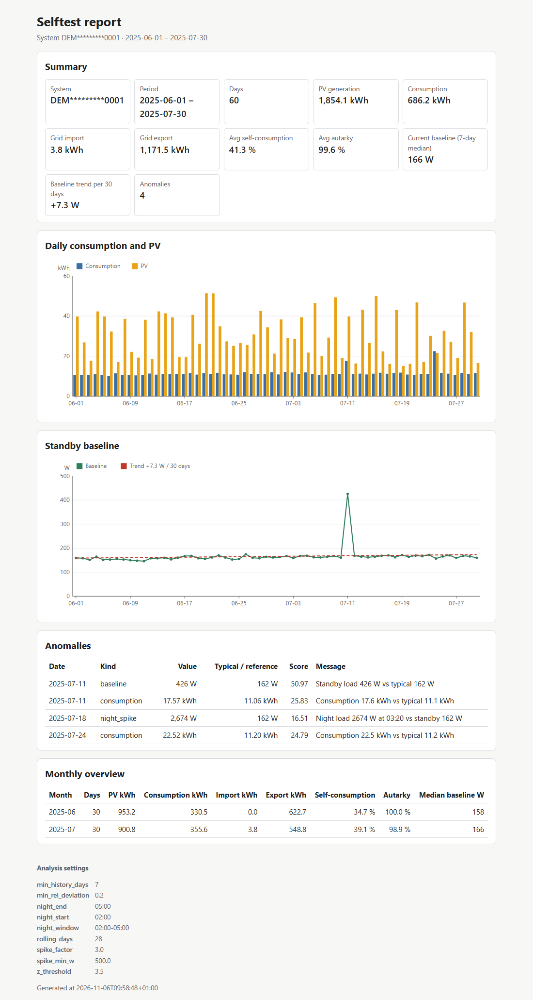

# AlphaESS Energy Analyzer

Pulls your AlphaESS system's data from the AlphaESS Open API into a local SQLite file, analyzes
it and writes a single offline HTML report:

- **Standby baseline** – typical night-time load (median between 02:00 and 05:00 while PV is 0),
  per day, with its trend over time
- **Self-consumption and self-sufficiency (autarky)** per day and per month
- **Anomalies** – days whose standby load or total consumption is far from the rolling median
  (robust z-score), and unusual night-time load spikes
- **Monthly summary table**



*The screenshot uses the synthetic demo data that ships with the tool (`energy-analyzer selftest`).*

> **Unofficial community project.** Not affiliated with, endorsed by or supported by Alpha ESS.
> Use at your own risk, respect the API's rate limits and terms of use.

## Requirements

- Python 3.10 or newer (Linux, macOS or Windows), or Docker
- An AlphaESS system and a free developer account for the AlphaESS Open API
- No other dependencies: the tool only uses the Python standard library

## Get Open API credentials

1. Register a developer account at [open.alphaess.com](https://open.alphaess.com).
2. In the developer account, add your system: you need its serial number (SN, shown in the
   AlphaESS app and on the device) and the check code / verification the portal asks for.
3. Copy your **Developer ID** (`ALPHA_APP_ID`) and **Developer Key** (`ALPHA_APP_SECRET`).
   Treat the key like a password.

The portal's own documentation needs a login; this README only describes the steps in its own
words. If anything differs, the portal is right.

## Quickstart (Linux / macOS)

```bash
git clone https://github.com/wintermute422/alphaess-energy-analyzer.git
cd alphaess-energy-analyzer
python3 -m venv .venv && . .venv/bin/activate
pip install .
energy-analyzer selftest --keep demo      # no account needed; open demo/selftest-report.html
energy-analyzer init                      # creates config.toml, .env.example and energy.db here
cp .env.example .env && chmod 600 .env    # now put your Developer ID and Key into .env
energy-analyzer init                      # checks the credentials (lists your systems)
energy-analyzer backfill --from 2025-01-01 --to 2025-01-31 && energy-analyzer report --out report.html
```

Open `report.html` in any browser – it works offline. On Windows use
`py -m venv .venv` and `.venv\Scripts\activate` instead of the third line.

Backfills are slow on purpose: one day needs two API calls and the tool waits at least 10 seconds
between calls, so a month takes about 10 minutes and a year about 2 hours. Interrupting is safe;
already fetched days are kept, and running the same range again does not create duplicates.

## Commands

| Command | What it does |
|---|---|
| `energy-analyzer init [--dir DIR] [--no-check]` | create `config.toml`, `.env.example` and the database; check credentials via `getEssList` |
| `energy-analyzer backfill --from YYYY-MM-DD --to YYYY-MM-DD` | fetch a date range, one day at a time |
| `energy-analyzer daily [--report report.html]` | fetch yesterday and today (idempotent), optionally regenerate the report |
| `energy-analyzer report --out report.html [--from ...] [--to ...]` | analyze the database and write the report |
| `energy-analyzer live` | print the latest live power values |
| `energy-analyzer selftest [--keep DIR]` | run the whole pipeline on built-in synthetic data (no network, no credentials) |

Global options: `--config PATH`, `--env-file PATH`, `--db PATH`, `--sn SERIAL`, `-v`.
Exit codes: `0` ok, `1` error, `2` configuration/credential problem, `3` API unavailable.

## Configuration reference

Settings are read from (later wins): built-in defaults → `config.toml` → `.env` → environment
variables → command line flags. Relative paths in `config.toml` are relative to that file.

| Setting | config.toml | Environment / .env | Default |
|---|---|---|---|
| Developer ID | – | `ALPHA_APP_ID` | – |
| Developer Key | – | `ALPHA_APP_SECRET` | – |
| System serial (only if the account has several) | `[system] sn` | `ALPHA_SYSTEM_SN` | the only system |
| Database file | `[storage] db` | `ENERGY_DB` | `energy.db` |
| Config file | – | `ENERGY_CONFIG` | `./config.toml` |
| Seconds between API calls (≥ 10) | `[api] min_interval_s` | – | `10` |
| Request timeout / retries | `[api] timeout_s`, `max_retries` | – | `30`, `4` |
| Night window for the baseline | `[analysis] night_start`, `night_end` | – | `02:00`, `05:00` |
| Rolling window for anomalies (days) | `[analysis] rolling_days` | – | `28` |
| Robust z-score threshold | `[analysis] z_threshold` | – | `3.5` |
| Minimum relative deviation to flag | `[analysis] min_rel_deviation` | – | `0.2` (20 %) |
| Night spike: factor over baseline / minimum watts | `[analysis] spike_factor`, `spike_min_w` | – | `3.0`, `500` |
| History needed before flagging (days) | `[analysis] min_history_days` | – | `7` |
| Report title | `[report] title` | – | `Energy report` |

`energy-analyzer init` writes a commented `config.toml` with all of these.

**How the numbers are computed.** Daily energy comes from `getOneDateEnergyBySn`; consumption is
derived by energy balance (PV + grid import + battery discharge − feed-in − battery charge). The
5-minute power series (`getOneDayPowerBySn`) has no battery power, so it is derived from the
balance as well. Self-consumption = (PV − feed-in) / PV; autarky = 1 − grid import / consumption.
A day is an anomaly when its robust z-score (median/MAD of the previous `rolling_days` days)
exceeds `z_threshold` **and** it differs by at least `min_rel_deviation` from that median.

## Scheduling

Run `energy-analyzer daily --report report.html` once a night. See
[docs/scheduling.md](docs/scheduling.md) for a systemd user timer, a cron line and Docker.
The repo also contains `deploy.sh` / `rollback.sh` to install the tool on another Linux machine
over SSH with versioned releases (see [docs/deploy.md](docs/deploy.md)).

## Docker

```bash
mkdir -p data
docker compose run --rm energy-analyzer selftest
docker compose run --rm energy-analyzer init          # then: cp data/.env.example data/.env
docker compose run --rm energy-analyzer backfill --from 2025-01-01 --to 2025-01-07
docker compose run --rm energy-analyzer daily --report report.html
```

Everything (config, credentials, database, report) lives in `./data`.

## Troubleshooting

| Message | Fix |
|---|---|
| `AlphaESS credentials missing` | create `.env` next to `config.toml` (or in the current folder) with `ALPHA_APP_ID` and `ALPHA_APP_SECRET` |
| `authentication failed (code 6007 …)` | wrong Developer ID/Key, or the computer clock is far off (the signature contains a timestamp) |
| `code 6005` / `system … is not in this developer account` | add the system to your developer account on open.alphaess.com |
| `this developer account has N systems` | set `ALPHA_SYSTEM_SN` or pass `--sn` |
| `The request was too fast` (6053) | handled automatically with backoff; do not lower `min_interval_s` |
| `the database has no data yet` | run `backfill` (or `daily`) before `report` |
| Report shows no baseline | no night samples with PV = 0 in the window – adjust `night_start`/`night_end` |

Run with `-v` for debug logging. Logs never contain your key, and serials are always masked.

## Privacy

All data stays on your machine: the database and the report are local files. The tool talks to
the AlphaESS Open API and nothing else – no telemetry, no CDN, no external resources in the
report. Your report reveals when you are at home, so think before sharing it. The repository
contains only synthetic sample data.

## Development

See [CONTRIBUTING.md](CONTRIBUTING.md). Security issues: [SECURITY.md](SECURITY.md).

## Credits

Endpoint names and return codes were cross-checked against the community library
[alphaessopenapi](https://github.com/CharlesGillanders/alphaess-openAPI) by Charles Gillanders
(MIT). This project does not use or copy its code; the API client is written from scratch on the
standard library.

## License

[MIT](LICENSE). Not affiliated with or endorsed by Alpha ESS; "AlphaESS" is used only to describe
compatibility.
