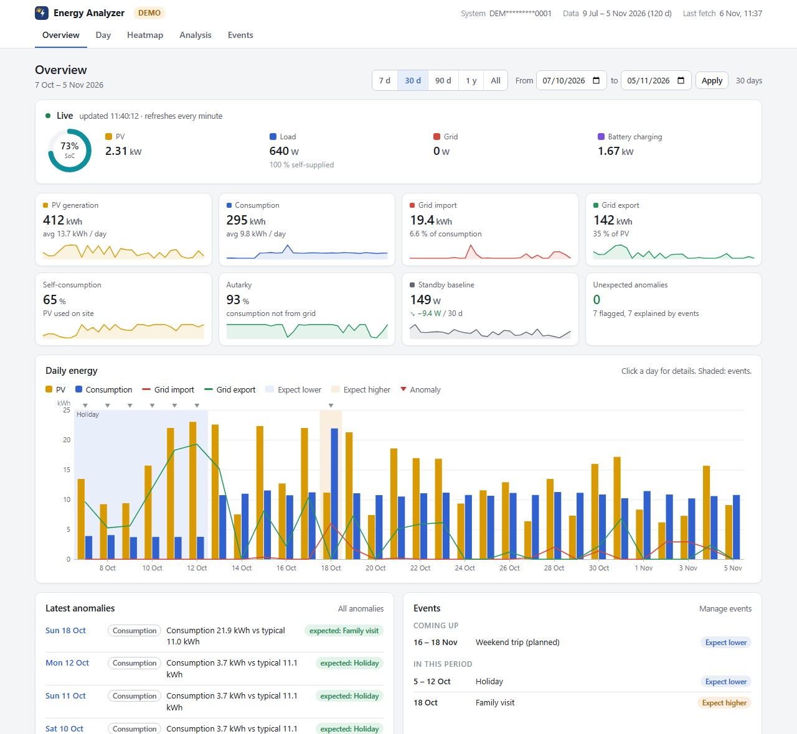
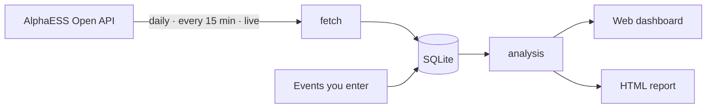
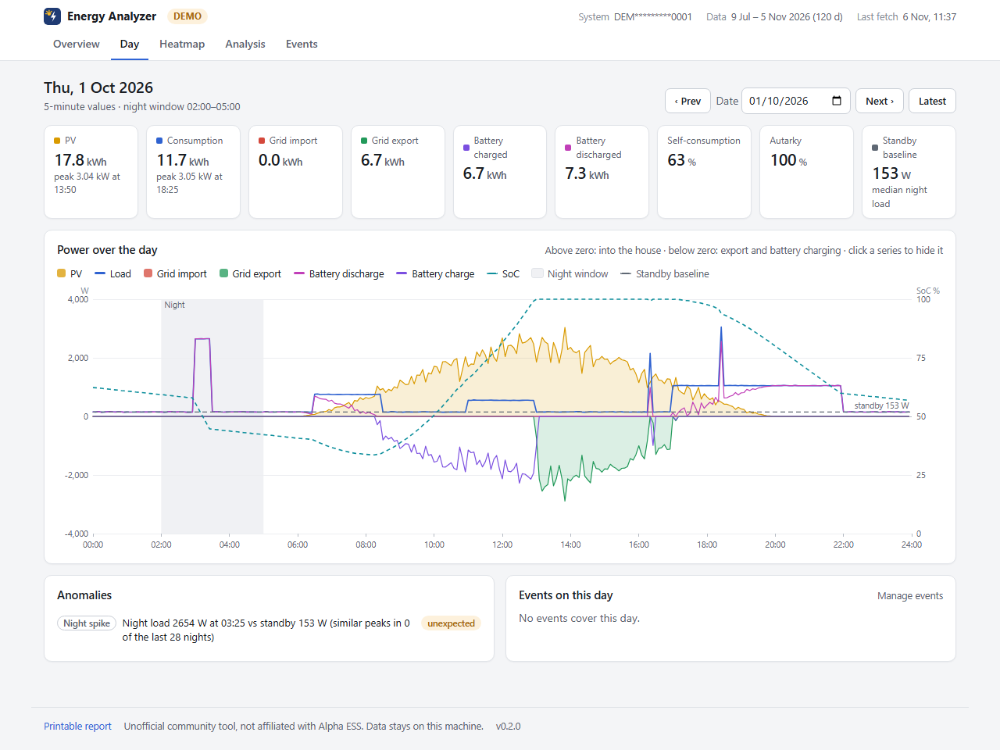
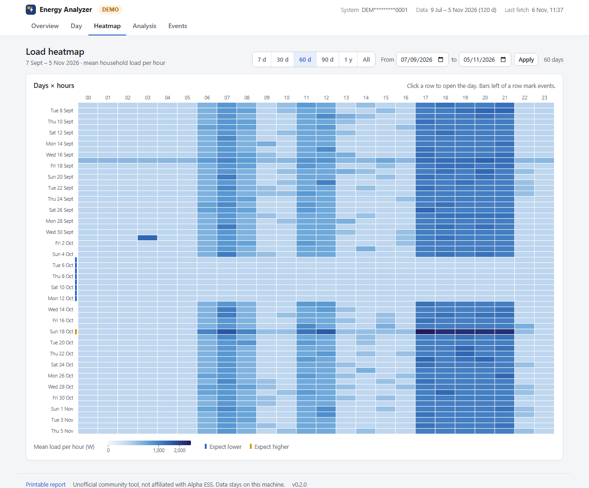
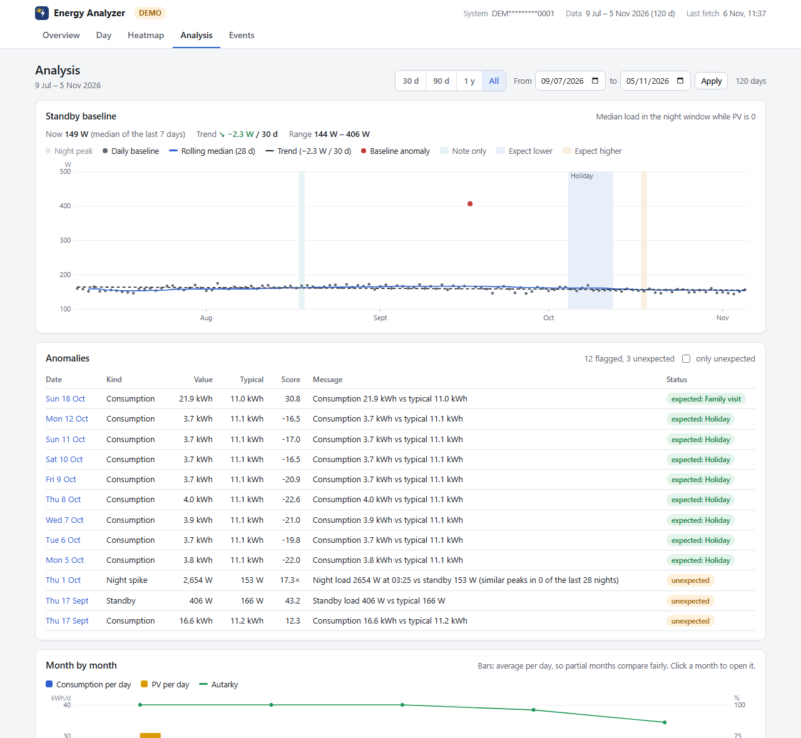
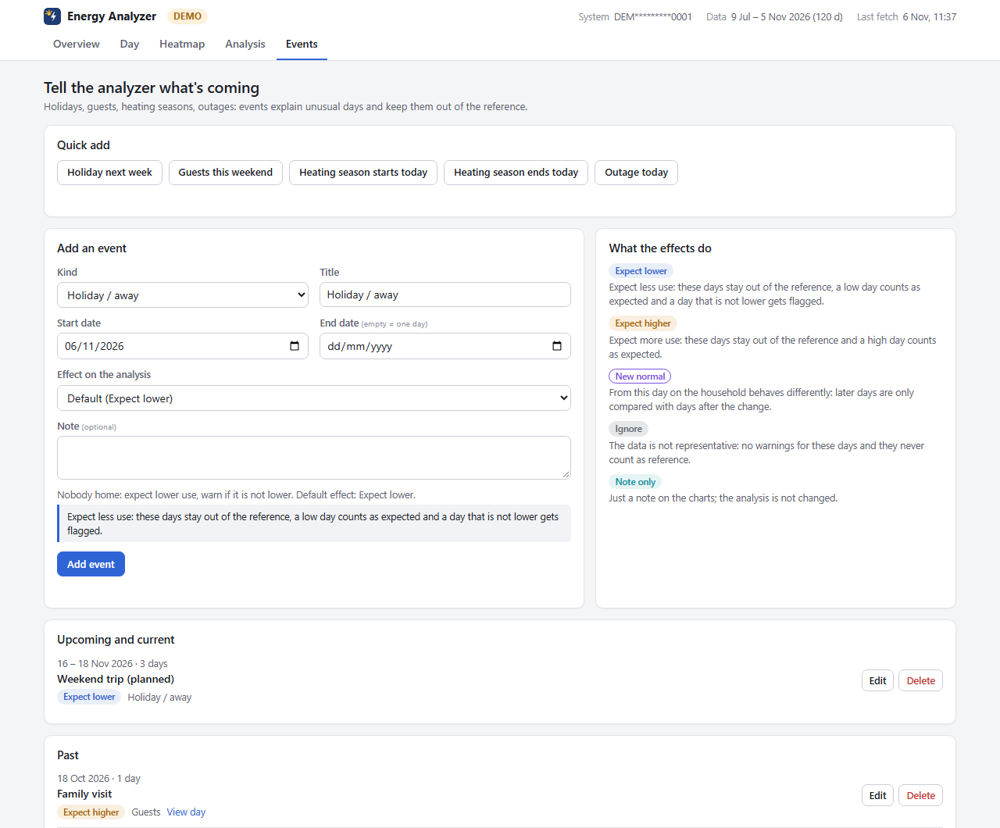
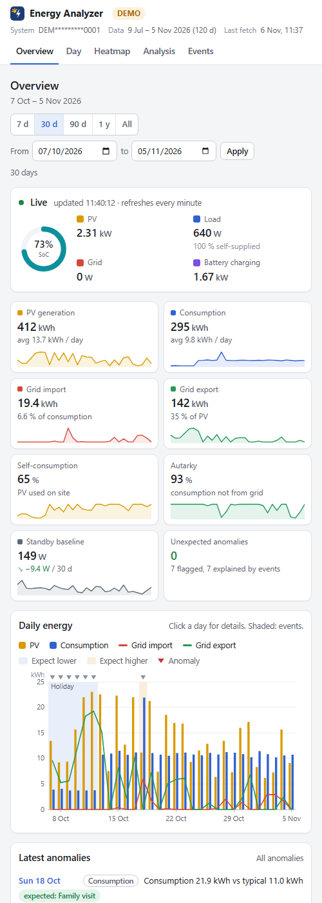

# AlphaESS Energy Analyzer

[](https://github.com/wintermute422/alphaess-energy-analyzer/actions/workflows/ci.yml)
[](CHANGELOG.md)
[](pyproject.toml)
[](LICENSE)

**Understand your AlphaESS solar and battery system.** The tool pulls your data from the
AlphaESS Open API into a local SQLite file, and shows it in a web dashboard and an offline HTML
report. It finds your standby consumption, your self-sufficiency, and the days and nights that
don't look like the rest.



> **Unofficial community project.** Not affiliated with, endorsed by or supported by Alpha ESS.
> Use at your own risk, respect the API's rate limits and terms of use.
> Deutsch: [Kurzanleitung](README.de.md)

## Contents

- [What you get](#what-you-get)
- [Try it in 2 minutes (no account needed)](#try-it-in-2-minutes-no-account-needed)
- [Requirements](#requirements)
- [Get Open API credentials](#get-open-api-credentials)
- [Quickstart](#quickstart)
- [The dashboard](#the-dashboard)
- [Events: tell the analyzer what's going on](#events-tell-the-analyzer-whats-going-on)
- [Running it permanently](#running-it-permanently) (systemd, cron, Docker, deploy to a server)
- [Commands](#commands) · [Configuration reference](#configuration-reference) ·
  [How the analysis works](#how-the-analysis-works)
- [Troubleshooting](#troubleshooting) · [FAQ](#faq) · [Privacy](#privacy)
- [Project layout](#project-layout) · [Contributing](#contributing) · [Credits](#credits) ·
  [License](#license)

## What you get

- **Web dashboard** with live values, daily energy, a 5-minute day view, a load heatmap, an
  analysis page and an events page. It works on desktop and phone, in light and dark mode,
  and is protected by a login when other devices can reach it.
- **Standby baseline**: the typical night-time load (median between 02:00 and 05:00 while PV
  is 0) for every day, with its trend over time.
- **Self-consumption and self-sufficiency (autarky)** per day, per month and for any period.
- **Anomaly detection**: days whose standby load or consumption is far from normal, night
  loads that are rare for your household, and holidays that didn't use less energy. A heat
  pump that starts on many nights is learned as normal.
- **Events**: record holidays, guests, heating seasons, new appliances or outages, and the
  analysis takes them into account.
- **Single-file HTML report** for archiving or sharing.
- **Runs anywhere Python 3.10+ runs**, with no dependencies beyond the standard library.
  Optional Docker image and a one-command deployment to a Linux server.
- **Your data stays local**: the only connection is to the AlphaESS API.



## Try it in 2 minutes (no account needed)

The dashboard ships with 120 days of synthetic demo data:

```bash
git clone https://github.com/wintermute422/alphaess-energy-analyzer.git
cd alphaess-energy-analyzer
python3 -m venv .venv && . .venv/bin/activate
pip install .
energy-analyzer serve --demo
```

Open <http://localhost:8088/>. On Windows, use `py -m venv .venv` and `.venv\Scripts\activate`
for the third line.

## Requirements

- Python 3.10 or newer (Linux, macOS or Windows), or Docker
- An AlphaESS system and a free developer account for the AlphaESS Open API
- For the always-on setup: a machine that runs 24/7 (Raspberry Pi, NAS, home server) with
  systemd or cron

## Get Open API credentials

1. Register a developer account at [open.alphaess.com](https://open.alphaess.com).
2. In the developer account, add your system. You need its serial number (SN, shown in the
   AlphaESS app and on the device) and the check code or verification the portal asks for.
3. Copy your **Developer ID** (`ALPHA_APP_ID`) and **Developer Key** (`ALPHA_APP_SECRET`).
   Treat the key like a password.

The portal's own documentation needs a login, so this README only describes the steps in its
own words. If anything differs, the portal is right.

## Quickstart

```bash
git clone https://github.com/wintermute422/alphaess-energy-analyzer.git
cd alphaess-energy-analyzer
python3 -m venv .venv && . .venv/bin/activate
pip install .
energy-analyzer selftest --keep demo      # no account needed; open demo/selftest-report.html
energy-analyzer init                      # creates config.toml, .env.example and energy.db here
cp .env.example .env && chmod 600 .env    # now put your Developer ID and Key into .env
energy-analyzer init                      # checks the credentials (lists your systems)
energy-analyzer backfill --from 2025-01-01 --to 2025-01-31 && energy-analyzer report --out report.html
```

Then start the dashboard on your own data:

```bash
energy-analyzer serve                     # http://localhost:8088/ (this machine only)
```

Backfills are slow on purpose: one day needs two API calls and the tool waits at least 10
seconds between calls, so a month takes about 10 minutes and a year about 2 hours.
Interrupting is safe: days already fetched are kept, and fetching the same range again creates
no duplicates.

## The dashboard

`energy-analyzer serve` serves the dashboard on port 8088. It only listens on this machine
unless you configure a login (see [Running it permanently](#running-it-permanently)).

| Overview | Day detail |
|---|---|
|  |  |
| KPIs for any period, live values every minute, daily PV vs. consumption with events shaded, latest anomalies | 5-minute curves of PV, load, grid and battery, plus state of charge, the night window and the standby level |

| Load heatmap | Analysis |
|---|---|
|  |  |
| Average load per hour and day: habits, the heat pump and standby at a glance. Click a row to open that day | Standby trend, every anomaly with its explanation, monthly comparison, the analysis settings in use |

| Events | On a phone |
|---|---|
|  |  |
| Tell the analyzer about holidays, guests, heating seasons or outages, including future ones | Every view adapts to small screens |

There is also a printable single-file report at `/report.html` (or
`energy-analyzer report --out report.html`):

<details><summary>Report screenshot</summary>


</details>

## Events: tell the analyzer what's going on

On the **Events** page you record what makes days unusual, ideally before they happen:

| Event | Effect on the analysis |
|---|---|
| Holiday / away | lower use is expected; a day that is *not* lower is flagged |
| Guests, home office, EV charging | higher use is expected and not reported as a problem |
| Heating / cooling season, new appliance | days are only compared with days after the change |
| Outage / maintenance | days are not judged and not used as a reference |
| Note | shown on the charts only |

Anomalies explained by an event are marked "expected" and don't count as unexpected.

## Running it permanently

Three jobs keep everything current:

| Job | Command | When |
|---|---|---|
| nightly fetch + report | `energy-analyzer daily --report report.html` | once a night, e.g. 03:30 |
| refresh for the dashboard | `energy-analyzer refresh` (today only, 2 API calls) | every 15 minutes |
| dashboard | `energy-analyzer serve --host 0.0.0.0` | always running |

To reach the dashboard from other devices in your home network, put a login password into
`.env` (`WEB_PASSWORD=...`; the user is `WEB_USER`, default `energy`). The server refuses to
listen beyond 127.0.0.1 without a password.

### Option A: deploy to a Linux server with one command (recommended)

From a clone on your PC, `deploy.sh` installs the committed version on a Linux machine over
SSH, with no root needed:

```bash
cp deploy.env.example deploy.env   # host, user, install path, web port, refresh interval
bash deploy.sh --dry-run
bash deploy.sh
```

It creates versioned releases with a `current` symlink, runs the selftest before switching,
installs the nightly timer, the 15-minute refresh timer and the dashboard as systemd **user**
services, copies your `.env` once, and generates a dashboard password on the server. The
password is never printed; read it there with `grep WEB_PASSWORD <path>/shared/.env`.
`bash rollback.sh` switches back to the previous release. Details: [docs/deploy.md](docs/deploy.md).

### Option B: systemd timers or cron by hand

Templates and examples are in [systemd/](systemd/) and [docs/scheduling.md](docs/scheduling.md).

### Option C: Docker

```bash
mkdir -p data
docker compose run --rm energy-analyzer init          # then: cp data/.env.example data/.env
docker compose run --rm energy-analyzer backfill --from 2025-01-01 --to 2025-01-07
docker compose run --rm energy-analyzer daily --report report.html
```

Config, credentials, database and report all live in `./data`.

## Commands

| Command | What it does |
|---|---|
| `energy-analyzer init [--dir DIR] [--no-check]` | create `config.toml`, `.env.example` and the database; check credentials via `getEssList` |
| `energy-analyzer backfill --from YYYY-MM-DD --to YYYY-MM-DD` | fetch a date range, one day at a time |
| `energy-analyzer daily [--report report.html]` | fetch yesterday and today (safe to repeat), optionally regenerate the report |
| `energy-analyzer refresh` | fetch today only (2 API calls) |
| `energy-analyzer report --out report.html [--from ...] [--to ...]` | analyze the database and write the report |
| `energy-analyzer serve [--host H] [--port P] [--demo]` | run the web dashboard |
| `energy-analyzer live` | print the latest live power values |
| `energy-analyzer selftest [--keep DIR]` | run the whole pipeline on built-in synthetic data (no network, no credentials) |

Global options: `--config PATH`, `--env-file PATH`, `--db PATH`, `--sn SERIAL`, `-v`.
Exit codes: `0` ok, `1` error, `2` configuration or credential problem, `3` API unavailable.

## Configuration reference

Settings are read in this order, later sources winning: built-in defaults, `config.toml`,
`.env`, environment variables, command-line flags. Relative paths in `config.toml` are relative
to that file. `energy-analyzer init` writes a commented `config.toml` with all of these.

| Setting | config.toml | Environment / .env | Default |
|---|---|---|---|
| Developer ID | – | `ALPHA_APP_ID` | – |
| Developer Key | – | `ALPHA_APP_SECRET` | – |
| System serial (only if the account has several) | `[system] sn` | `ALPHA_SYSTEM_SN` | the only system |
| Database file | `[storage] db` | `ENERGY_DB` | `energy.db` |
| Config file | – | `ENERGY_CONFIG` | `./config.toml` |
| Seconds between API calls (≥ 10) | `[api] min_interval_s` | – | `10` |
| Request timeout / retries | `[api] timeout_s`, `max_retries` | – | `30`, `4` |
| Night window for the baseline | `[analysis] night_start`, `night_end` | – | `02:00`, `05:00` |
| Rolling window for anomalies (days) | `[analysis] rolling_days` | – | `28` |
| Robust z-score threshold | `[analysis] z_threshold` | – | `3.5` |
| Minimum relative deviation to flag | `[analysis] min_rel_deviation` | – | `0.2` (20 %) |
| Night spike: factor over baseline / minimum watts | `[analysis] spike_factor`, `spike_min_w` | – | `3.0`, `500` |
| Night spike counts as routine if this share of recent nights had one | `[analysis] spike_routine_share` | – | `0.25` |
| History needed before flagging (days) | `[analysis] min_history_days` | – | `7` |
| Report title | `[report] title` | – | `Energy report` |
| Dashboard address / port | `[web] host`, `port` | `WEB_HOST`, `WEB_PORT` | `127.0.0.1`, `8088` |
| Dashboard login | `[web] user` | `WEB_USER`, `WEB_PASSWORD` | `energy`, none |

## How the analysis works

- **Daily energy** comes from `getOneDateEnergyBySn`. Consumption is derived by energy balance:
  PV + grid import + battery discharge − feed-in − battery charge.
- **Battery power** isn't part of the 5-minute series (`getOneDayPowerBySn`), so it is also
  derived from the balance. It therefore includes inverter and battery conversion losses:
  treat the intraday battery curve as an approximation and the daily totals as authoritative.
- **Self-consumption** is (PV − feed-in) / PV. **Autarky** is 1 − grid import / consumption.
- **Standby baseline** is the median load in the night window while PV is 0. Its trend uses a
  robust Theil–Sen slope, so a single odd day doesn't tilt it.
- **Anomalies (baseline, consumption):** a day is flagged when its robust z-score
  (median/MAD of the previous `rolling_days` days) exceeds `z_threshold` **and** it differs by
  at least `min_rel_deviation` from that median. Days inside holiday, guest or outage events
  are left out of the reference, and a heating-season or new-appliance event starts a new
  reference period.
- **Night spikes:** a night load must exceed `spike_factor` × baseline by `spike_min_w`. Once
  a week of history exists it must also be rare: if at least `spike_routine_share` (25 %) of
  the recent nights reached a similar peak, it is routine.

The HTTP API behind the dashboard is documented in [docs/web-api.md](docs/web-api.md).

## Troubleshooting

| Message | Fix |
|---|---|
| `AlphaESS credentials missing` | create `.env` next to `config.toml` (or in the current folder) with `ALPHA_APP_ID` and `ALPHA_APP_SECRET` |
| `authentication failed (code 6007 …)` | wrong Developer ID/Key, or the computer clock is far off (the signature contains a timestamp) |
| `code 6005` / `system … is not in this developer account` | add the system to your developer account on open.alphaess.com |
| `this developer account has N systems` | set `ALPHA_SYSTEM_SN` or pass `--sn` |
| `The request was too fast` (6053) | handled automatically with backoff; don't lower `min_interval_s` |
| `the database has no data yet` | run `backfill` (or `daily`) before `report` |
| `refusing to serve on … without a password` | set `WEB_PASSWORD` in `.env`, or serve on 127.0.0.1 only |
| Dashboard not reachable from other devices | check the host's firewall allows the port (e.g. `sudo ufw allow 8088/tcp` for your LAN) |
| The browser asks for a login again and again | user is `WEB_USER` (default `energy`), password `WEB_PASSWORD` from the server's `.env` |
| Report or dashboard shows no baseline | no night samples with PV = 0 in the window: adjust `night_start`/`night_end` |

Run with `-v` for debug logging. Logs never contain your key, and serials are always masked.

## FAQ

**Can it change settings on my inverter or battery?** No. It only reads data.

**How many API calls does it make?** About 5 per night, 2 every 15 minutes for the refresh,
and 1 per minute while a dashboard page shows live values. All calls are at least 10 seconds
apart.

**Several systems in one developer account?** Pick one with `ALPHA_SYSTEM_SN` or `--sn`, and
use a separate folder and database per system.

**Does it work with Home Assistant?** Not directly. It is a standalone tool, and the SQLite
file and the JSON API ([docs/web-api.md](docs/web-api.md)) are easy to read from elsewhere.

**Why is the heat pump flagged during the first week?** Without a week of history there is
nothing to compare with. You can also add a "Heating season starts" event.

## Privacy

All data stays on your machine: the database, the report and the dashboard are local. The tool
talks to the AlphaESS Open API and nothing else, with no telemetry and no external resources in
the report or the dashboard. Your energy data reveals when you are at home, so protect the
dashboard with a password and think before sharing a report. The repository contains only
synthetic sample data.

## Project layout

| Path | What's inside |
|---|---|
| `src/energy_analyzer/fetch.py` | signed Open API client, rate limiting, fetch jobs |
| `src/energy_analyzer/storage.py` | SQLite schema, migrations, upserts |
| `src/energy_analyzer/analyze.py`, `events.py` | statistics, anomalies, events and their effects |
| `src/energy_analyzer/web.py`, `web/` | dashboard server and UI (vanilla JS, SVG charts) |
| `src/energy_analyzer/report.py` | single-file HTML report |
| `src/energy_analyzer/cli.py` | the `energy-analyzer` command |
| `src/energy_analyzer/synthetic.py`, `demo.py`, `selftest.py` | synthetic data, demo mode, selftest |
| `tests/`, `sample_data/` | pytest suite (no network) and synthetic API fixtures |
| `deploy.sh`, `rollback.sh`, `systemd/` | server deployment |
| `docs/` | API, deployment and scheduling docs, screenshots |
| `scripts/`, `.githooks/` | quality gate (`scripts/check.sh`) and secret-scanning git hooks |

## Contributing

Bug reports and pull requests are welcome. Please read [CONTRIBUTING.md](CONTRIBUTING.md) and
never post real credentials, serials or consumption data in issues. Security issues:
[SECURITY.md](SECURITY.md). Changes per version: [CHANGELOG.md](CHANGELOG.md).

## Credits

Endpoint names and return codes were cross-checked against the community library
[alphaessopenapi](https://github.com/CharlesGillanders/alphaess-openAPI) by Charles Gillanders
(MIT). This project doesn't use or copy its code; the API client is written from scratch on the
standard library.

## License

[MIT](LICENSE). Not affiliated with or endorsed by Alpha ESS. "AlphaESS" is used only to
describe compatibility.
